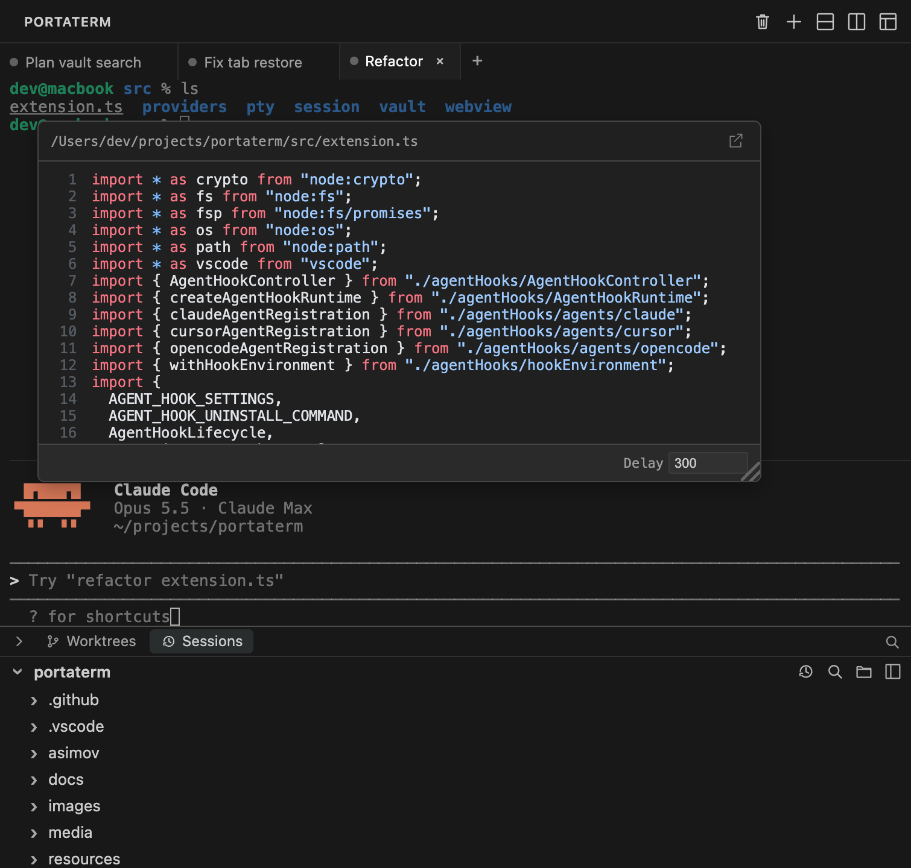
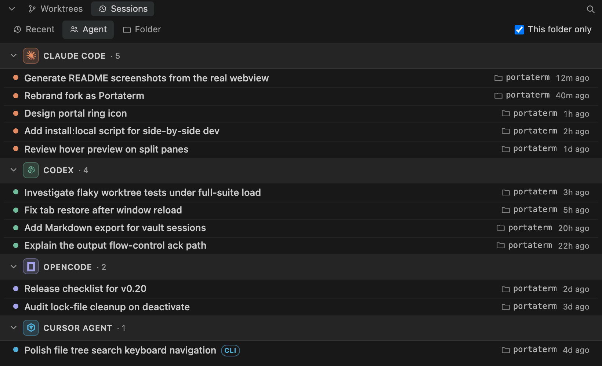
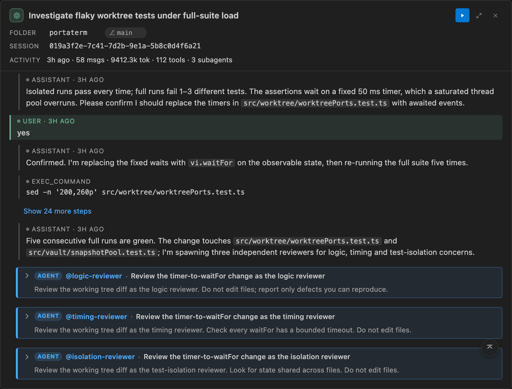

# Portaterm

> Fork of [AnyWhere Terminal](https://github.com/huybuidac/anywhere-terminal) by Huy Bui Dac (MIT), extended with additional features.

**A real terminal you can put anywhere in VS Code or Cursor — and a home base for your AI coding agents.**

Sidebar, secondary sidebar, bottom panel, or an editor tab. Split it, tab it, theme it. Then preview and continue **Claude Code · Codex · OpenCode · Cursor Agent CLI · Cursor IDE** history, resume compatible CLI chats, open file paths straight from agent output, and keep your shell alive across reloads.

🌐 **Website:** [portaterm.mhd.dev](https://portaterm.mhd.dev/)




## Install

**VS Code** — search `Portaterm` in Extensions ([Marketplace](https://marketplace.visualstudio.com/items?itemName=mhd.portaterm)), or:

```
ext install mhd.portaterm
```

**Cursor, Windsurf, Antigravity, VSCodium & other VS Code-compatible editors** — search `Portaterm` (published to [Open VSX](https://open-vsx.org/extension/mhd/portaterm)).

Portaterm uses its own extension ID (`mhd.portaterm`) and settings namespace (`portaterm.*`), so it can be installed alongside the upstream AnyWhere Terminal.

## Quickstart

1. Click the **Portaterm** icon in the Activity Bar — a session starts automatically.
2. Drag the view to **any** sidebar, panel, or editor group.
3. Use the title bar to add tabs or split panes. Right-click for context actions.
4. Open the **AI Vault** from the panel header (or `Portaterm: Open AI Vault`) to browse and continue your AI-CLI sessions.

## At a glance

- 🧭 **Put the terminal anywhere** — sidebar, secondary sidebar, bottom panel, or editor tab
- 🤖 **AI Coding Vault** — preview Claude Code / Codex / OpenCode / Cursor CLI / Cursor IDE history, with CLI-only Cursor Resume and provider-supported continuation
- 🔗 **AI-CLI-aware** — clickable paths, file hover previews, and pasted-image previews in agent output
- 🪟 **Tabs + recursive split panes** with drag-to-resize, pane zoom, and broadcast input to type into every pane at once
- ♻️ **Survives reloads & restarts** — scrollback, names, cwd, and layout restore
- 📤 **Export** any command or full scrollback to a file
- 🎨 **Theme-aware, WebGL-rendered**, with an embedded file tree

---

## 🤖 AI Coding Vault

Claude Code, Codex, OpenCode, and Cursor Agent all keep local session data in different places — easy to lose track of across tools and folders. **AI Vault surfaces them in one panel, with each tool's supported actions and detail level.**



- **Preview first, then choose an action** — click, Enter, or Space opens every supported row preview; double-click a resumable row to resume it straight away. Resume Claude Code / Codex / OpenCode sessions; Cursor Resume is an explicit action available only for validated CLI chats. Cursor IDE and project-mirror entries are non-resumable.
- **Group your way** — **Recent**, **Agent**, or **Folder** grouping (persisted), with Claude / Codex / OpenCode / Cursor identity and per-agent accents. A session running in a pinned tab is pinned to the top of its group, followed by your starred sessions.
- **Start an agent from its group** — in **Agent** grouping, hover an agent's header and click **+** to start a new session of that agent in the workspace root with its default permission mode — in the active tab if it is a fresh shell nobody has typed into, otherwise in a new tab. Shown only for agents installed on this machine.
- **See what's already open** — a session that a terminal pane is running carries a **Tab** mark and moves to the top of its group, right after pinned and starred sessions. **Resume** brings that tab forward instead of starting a second agent on the same conversation. The mark names what the agent is doing in its own colour — `running`, `approve`, `answer`, or `done` when it finished while you were elsewhere — matching the tab's status dot.
- **Rename once** — renaming a session in the Vault renames the open tab running it, and renaming the tab renames the session. OpenCode and Codex keep the name in their own store.
- **Star and tag what matters** — star a session from its row (hover), its right-click menu, or the preview header; unlike a tab pin, a star stays when the tab closes and across restarts, and starred sessions lead their group. **Edit Tags…** on the right-click menu picks from the tags you already use or adds new ones; tags show as `#tag` chips on the row. Stars and tags are kept by Portaterm, never written into an agent's files.
- **Find it fast** — client-side search over titles, your renames, folders, agents and tags (type `#tag` to match tags only, or click a row's chip), plus a **Starred only** toggle and a **"This folder only"** filter, on by default, scoped to the focused terminal's working directory. When that folder has no sessions, **Show all sessions** turns the filter off.
- **Settings one click away** — the gear next to search opens VS Code's Settings filtered to Portaterm.
- **Right-click for more** — provider-supported actions such as Resume, Reveal in Finder/Explorer, Copy File Path or Resume Command, and Open Working Directory.
- **Cross-platform** — store locations resolve per-OS (honoring `CLAUDE_CONFIG_DIR`, `CODEX_HOME` / `CODEX_SQLITE_HOME`, `XDG_DATA_HOME`); falls back to a built-in SQLite engine when the `sqlite3` CLI is missing (typically Windows). A missing store degrades to an empty list, never an error.

> **Privacy:** the panel reads each tool's own local store. For instant open it keeps a small, **owner-only metadata cache** (bounded titles, working directories, source labels, and freshness stamps) under VS Code storage — non-authoritative, never the source of truth. Cursor transcript detail is decoded only after an explicit preview request, locally, read-only, and under strict per-record and total bounds. Raw SQLite/protobuf blobs, keys, private database fields, raw hook payloads, account data, and shell output are never sent to the webview, persisted in the Vault cache, or logged. Unsupported or changed schemas fall back to metadata-only detail. **Nothing is sent off your machine.**

### Session preview

Activate a supported transcript row to open a movable, content-rich floating preview — without leaving your terminal. Cursor CLI and IDE rows follow the same click / Enter / Space preview contract as Claude Code, Codex, and OpenCode; Resume remains a separate CLI-only action.



- **The whole story** — first prompt, a recent-activity timeline of tool and sub-agent steps, the latest assistant message, and activity stats (messages · tokens · cost · tools · sub-agents).
- **Where the tokens went** — the token count is everything the session sent and received. Hover it for a per-model breakdown (input, cache read, cache write, output) and cost, where the agent records one: Claude Code's own figure (subagents included) and OpenCode's. Hover the tool count to see which tools ran, and how often.
- **Nested sub-agents** — spawned sub-agents render as highlighted, accent-bordered blocks with an `agent` badge, including Codex sub-agent threads nested under their parent.
- **Questions & answers** — when a session uses the ask-the-user tool (Claude Code's `AskUserQuestion`, OpenCode's `question`, Codex's `request_user_input`), the preview shows the question, your choice, and a click-to-expand list of every option.
- **Export as Markdown** — the export button in the preview header, or **Export as Markdown…** on a row's context menu, writes the session's timeline to a `.md` file you can share with your team or paste into a PR description: a details table, then each message, with tool calls as lists and reasoning and sub-agent work in collapsed `<details>` blocks. Afterwards, open the file or copy the same Markdown.
- **Stays put** — remembers its size, position, and maximized state across reloads and restarts; drag the header to move it; a transient ↑ / ↓ control appears while scrolling.
- **Cursor source-aware previews** — `CLI` and `IDE` rows are labeled in the list and preview. Compatible CLI `store.db` graphs, project JSONL mirrors/fallbacks, and supported IDE Composer records render normalized bounded timelines; incompatible data falls back to metadata only. Raw-message copying and Cursor fork remain unavailable.
- **Cursor sub-agent drill-down** — a Cursor `Task` / `Agent` step opens as an `agent` card. When its result names a child agent saved in the same project, expanding the card loads that child's own transcript; otherwise the card keeps the invocation's bounded prompt and result. Child transcripts are view-only and never resumable.

### Cursor history and Agent CLI

Portaterm previews local history from both **Cursor Agent CLI** and **Cursor IDE Composer**, and launches only a **user-installed** Cursor Agent CLI. Install the CLI from Cursor's [official installation guide](https://prod.cursor.com/docs/cli/installation); the extension does not bundle, mirror, update, or redistribute Cursor's proprietary executable.

- **Executable resolution** — launch probes `agent` first, then the backward-compatible `cursor-agent` alias. The candidate must expose Cursor's interactive prompt, Resume, plan-mode, and force capabilities; the desktop-app launcher `cursor` is never used as the agent CLI.
- **Vault sources** — eligible CLI chats come from bounded `~/.cursor/chats/` metadata, with explicit detail decoding from compatible WAL-aware `store.db` snapshots and project JSONL mirrors. Supported Cursor IDE Composer headers and bubbles come from the local `globalStorage/state.vscdb`. List indexing and persisted caches remain metadata-only. Project transcripts under `~/.cursor/projects/` are never listed on their own — they are read only as an exact mirror of the same project's CLI chat, or as the child transcript a sub-agent card points at.
- **Actions** — row activation opens preview. A validated `CLI` row may explicitly Resume as `<detected-agent> --resume <chat-id>` or Continue in a new Cursor terminal. `IDE` entries never Resume, and project-history data never grants Resume capability; Cursor fork, cross-store Resume, and ACP embedding remain unsupported.
- **Proof before Resume** — Resume and Copy Resume Command first read the chat's own bounded store profile and require the stored agent identity to match the chat directory. A missing, locked, unreadable, unsupported, or mismatched store refuses the action before any executable is probed, so the clipboard is untouched and no terminal is created; the row itself stays in the list.
- **Optional status observation** — set machine-scoped `portaterm.cursorAgent.hooks.enabled` to `true` to show working, approval-required, and idle tab states. It defaults to `false`. Portaterm adds and removes only its owned entries in `~/.cursor/hooks.json`, preserves unrelated hooks, authenticates events to the matching live pane over loopback, and fails open if the observer is unavailable. Recent PTY output remains the fallback when hooks are disabled or stale.
- **Hook privacy** — observation uses status event names only. Prompt text, shell output, raw hook bodies, account identity, and transcript content are not persisted, logged, cached, or posted to the webview.
- **Troubleshooting** — run `agent status` (or `cursor-agent status`) to verify authentication and `agent --help` to verify the expected capabilities. If hook setup cannot safely reconcile the user-owned config, or the native Windows wrapper cannot pass its no-op probe, Cursor remains usable and the tab falls back to PTY-output activity.

## 🔗 Made for AI coding CLIs

Running an agent in the terminal floods it with file paths, diffs, and image attachments. Portaterm makes that output **navigable**.

- **Clickable file paths** — paths in terminal output are underlined and open in the editor on click, jumping to the parsed line/column. Understands `src/foo.ts:42:7`, line ranges, Python tracebacks, Windows paths, `file://` URIs, and Claude/Codex CLI line-wrapping (`Read(/abs/path · lines 180-299)`).
- **Hover to preview** — hover any path for a syntax-highlighted (Shiki) preview with line numbers and markdown rendering; the target line scrolls into view. A trust-policy gate keeps dotfiles and sensitive folders from auto-previewing — press `Cmd`/`Ctrl` to override for one file.
- **Pasted-image previews** — paste an image into Claude Code / Codex / OpenCode and the CLI shows a `[Image #N]` placeholder; hover it to see the image you actually attached. Captured locally at paste time — nothing is sent anywhere.

## 🪟 Put it anywhere

The built-in terminal is awkward to reposition and can't live in the sidebar. Portaterm lets you put a full terminal **anywhere** — without losing PTY semantics, WebGL rendering, theming, or clickable links.

- **Place it anywhere** — Primary Sidebar, Secondary Sidebar, Bottom Panel, or Editor Tab; each location remembers its own state.
- **Tabs + split panes** — horizontal/vertical splits with drag-to-resize, recursive. With more tabs than fit, the active tab is always scrolled into view and a **+N** mark counts the tabs past the right edge.
- **Pane zoom** — press `Cmd+Shift+Enter` (`Ctrl+Shift+Enter` on Windows/Linux), right-click a split pane → **Zoom Pane**, or run `Portaterm: Toggle Pane Zoom` to show one pane at the tab's full size. The other panes and their shells keep running, hidden; a mark on the tab shows it is zoomed. Press it again, or choose **Unzoom Pane**, to get the layout back exactly as it was — moving focus to another pane, splitting, or closing a pane also ends the zoom.
- **Broadcast input** — right-click a split pane → **Broadcast Input to All Panes** (or `Portaterm: Toggle Broadcast Input to All Panes`) and what you type reaches every pane of that tab at once. A red frame on each pane and a mark on the tab show it is on; it stops when you turn it off or the tab is back to one pane.
- **Real terminal** — `node-pty` backed, full shell support, adaptive flow control.
- **GPU rendering** — WebGL, smooth on Retina.
- **Theme aware** — follows your VS Code theme (dark / light / high contrast).
- **Know which agent needs you** — a tab whose Claude Code or Cursor Agent is waiting on an approval shows a yellow status dot, and one waiting on an answer a purple one, and the Portaterm view icon counts those tabs in a badge whose tooltip names them. A turn that finished while you were looking elsewhere leaves a blue dot until you type into that terminal or click it or its tab; switching back to the window alone does not clear it. A `Portaterm` status bar entry counts every agent in the window — working, waiting, done — and clicking it (or **Portaterm: Go to Agent**) lists them, most urgent first, with **Open Portaterm** below; with no agent running it opens Portaterm directly. Right-click the status bar to hide it. **Portaterm: Show Agent Attention State** dumps what the marks and badges were computed from, for one that looks wrong. Set `agentNotifications.enabled` for a notification, with a **Go to Tab** button, when the agent is out of sight.
- **Find in the terminal** — `Cmd+F` / `Ctrl+F` highlights every match in the scrollback, with a match counter, previous/next, and match case, whole word and regular expression toggles.
- **Smart clipboard** — `Cmd+C` / `Cmd+V`, selection-aware, with `Ctrl+C` fallback.
- **Clickable URLs** — `Cmd+Click` with confirmation.
- **Drop files to insert their path** — hold `Shift` and drop files from the Explorer or, on macOS, from Finder onto a terminal to type their quoted paths; or right-click a file in the Explorer, an editor tab or inside an open editor → **Insert Path in Portaterm**.
- **Embedded file tree** — browse the workspace alongside the terminal, with VS Code-style git decorations, live filesystem sync, in-panel search, and drag-a-row-into-a-pane to insert a path. Right-click a row for Reveal in Finder, Copy Path, Copy Relative Path, or Delete.

## Shortcuts

| Shortcut | Action |
|----------|--------|
| `Cmd+C` / `Cmd+V` | Copy / paste |
| `Cmd+K` | Clear terminal |
| `Cmd+F` | Find in the terminal — `Enter` / `Shift+Enter` (or `Cmd+G` / `Shift+Cmd+G`; `F3` / `Shift+F3` on Windows/Linux) step through matches, `Escape` closes |
| `Cmd+Backspace` | Kill input line |
| `Shift+Enter` | Insert newline |
| `Cmd+W` (Windows/Linux: `Ctrl+Shift+W`) | Close the active tab — only while a Portaterm view has focus |

Rename a root tab by double-clicking its label, choosing **Rename Tab…** from the tab context menu, or running **Portaterm: Rename Tab…** from the Command Palette. The box opens with the name the tab shows. Renaming a tab that runs an agent session also renames that session in the AI Vault. No default rename keybinding is shipped.

> Replace `Cmd` with `Ctrl` on non-macOS (Windows/Linux support in progress).

Run `Cmd+Shift+P` → `Portaterm:` for the full command list.

## Settings

Key settings under `portaterm.*` (see the Settings UI for the full list):

| Setting | Default | Description |
|---------|---------|-------------|
| `shell.macOS` | `""` | Custom shell path on macOS. Empty = auto-detect. |
| `shell.linux` | `""` | Custom shell path on Linux. Empty = auto-detect. |
| `shell.windows` | `""` | Custom shell path on Windows. Empty = auto-detect. |
| `shell.args` | `[]` | Custom shell args. Empty = sensible defaults. |
| `scrollback` | `10000` | Scrollback buffer lines. |
| `fontSize` | `0` | `0` = inherit from VS Code. |
| `fontFamily` | `""` | Empty = inherit from VS Code. |
| `cursorBlink` | `true` | Cursor blink. |
| `defaultCwd` | `""` | Empty = workspace root or `$HOME`. |
| `sessionRestore.enabled` | `true` | Restore terminal scrollback and metadata across VS Code restarts. |
| `sessionRestore.resumeClaude` | `all` | Which restored tabs resume the Claude conversation they were running: `all`, `pinned`, or `off`. |
| `agentNotifications.enabled` | `false` | Notify when an agent you cannot see is waiting for your approval or answer. |
| `agentNotifications.onTurnEnd` | `true` | Also notify when an agent you cannot see finishes its turn. |
| `cursorAgent.hooks.enabled` | `false` | Machine-scoped, fail-open Cursor Agent activity and approval observation. |
| `hoverPreview.enabled` | `true` | Show the hover preview popup for file paths and pasted images. Clicking a link still opens the file when off. |
| `hoverPreview.delay` | `300` | Debounce (ms) before the file hover preview fetches, range 100–2000. |
| `hoverPreview.blockSensitive` | `true` | Block auto-preview for dotfiles and sensitive folders (`Cmd`/`Ctrl` overrides). |
| `fileTree.autoReveal` | `true` | Reveal the active editor file in the file tree (`"focusNoScroll"` to skip scrolling). |

> **Shell auto-detect** (empty `shell.<platform>`): uses VS Code's resolved default shell (`vscode.env.shell`, which honors `terminal.integrated.defaultProfile` and the remote host), then falls back per platform — macOS `$SHELL → /bin/zsh → /bin/bash → /bin/sh`, Linux `$SHELL → /bin/bash → /bin/sh`, Windows `%ComSpec% → cmd.exe`.
>
> **Migrating from a single `shell.macOS`:** the shell setting is now per-platform. If you previously set `shell.macOS` on Linux or Windows as a workaround, move that value to `shell.linux` / `shell.windows` — the macOS key now applies only on macOS.

## Session restore

Terminals attempt to survive two distinct interruptions:

- **Window reload (`Cmd+R` / `workbench.action.reloadWindow`)** — every terminal location keeps its PTY alive across the reload. Editor-tab terminals use a 5 s grace window before tearing down; if VS Code revives the panel within that window (the normal case), the shell continues without interruption — including long-running processes like `npm run dev`.
- **Full restart (quit and relaunch VS Code, or open a fresh workspace)** — the shell process itself does **not** survive (a fresh PTY is spawned), but the scrollback, custom tab name, view location (sidebar / panel / editor), and last known `cwd` are restored. A dim divider line marks the boundary between the restored buffer and the new shell prompt: `─── restored — last update at HH:MM ───`. If the prior shell had exited, the divider includes the exit code and the restored tab is read-only. A tab that was running Claude when the window went away types `claude --resume <id>` into the new shell, so the conversation continues where it left off; set `portaterm.sessionRestore.resumeClaude` to `pinned` to limit this to pinned tabs, or `off` to turn it off.

Persistence is workspace-scoped (when a workspace folder is open): snapshots from workspace A are not surfaced in workspace B. Storage is capped at 20 snapshots per workspace, 1 MB per snapshot, and 7 days of age — whichever comes first. Disable the entire pipeline via `portaterm.sessionRestore.enabled` if you don't want any state written to disk; toggling the setting off also purges existing snapshots. When no workspace folder is open, persistence is disabled for that window (the no-folder global directory could otherwise leak snapshots between unrelated no-folder windows).

> **What's persisted**: the serialized xterm scrollback buffer is written verbatim to disk. **Anything echoed or displayed in the terminal — passwords typed at a prompt, `cat`'d `.env` files, `aws configure` output, API tokens pasted to verify, kubeconfigs printed via `kubectl config view`, etc. — is stored in plaintext** under VS Code's per-extension storage directory until evicted by the caps above. The clear-screen command (`Cmd+K` / right-click → Clear) now also clears the persisted buffer, so use it as a privacy boundary before screen-share or hand-off. If your shell often surfaces secrets and you don't want any of them on disk, set `portaterm.sessionRestore.enabled` to `false`.

> Process revive (the actual shell process surviving a full restart) is out of scope for this release. A future opt-in path may integrate `tmux` / `screen` / `zellij` for users who need that.

## Export terminal session

Three Command Palette entries write the active terminal's content to a file:

| Command | What it writes |
|---|---|
| **Portaterm: Export Buffer to File…** | Full scrollback of the focused terminal. Always available regardless of shell integration. |
| **Portaterm: Export Last Command Output…** | The most-recently-completed command (`$ <command>` + exit code + cwd + output). Requires shell integration. |
| **Portaterm: Export Command…** | Pick a tracked command from a quickpick (most-recent-first), then save. Requires shell integration. |

The save dialog offers two formats:

- **Text (ANSI stripped)** (default) — readable in any editor; ANSI escape codes removed via `strip-ansi`.
- **Raw (ANSI preserved)** — keeps color/cursor escapes so the file replays correctly in `cat` / `less -R`.

> **Exports include the literal command line, current working directory, exit code, and raw output of the terminal — review files before sharing.** Anything visible on screen ends up in the export, including credentials echoed at a prompt or secrets pasted into the shell.

### Shell integration

Per-command export ("Export Last Command Output" and "Export Command") relies on the same **OSC 633** shell-integration sequences that VS Code's built-in terminal uses. Portaterm auto-injects VS Code's MIT-licensed scripts at PTY spawn for these shells:

| Shell | macOS | Linux | Windows |
|---|---|---|---|
| bash | ✓ | ✓ | (Git Bash supported through the same injection) |
| zsh | ✓ | ✓ | — |
| fish | ✓ | ✓ | — |
| pwsh / pwsh.exe | ✓ | ✓ | ✓ |
| sh / dash / cmd / nushell / custom | not supported — export buffer still works | | |

If you launch the shell with `bash --noprofile --norc` or `pwsh -NoProfile`, the injection is skipped — the per-command commands then surface an info toast pointing here, and you can still use "Export Buffer to File…".

**Privacy**: the per-session UUID nonce that the parser uses to validate command-line metadata is set as the `VSCODE_NONCE` environment variable on the spawned shell only.

After a window reload, tracked commands reset to empty — the scrollback is restored from snapshot but the command list is not persisted. You'll see the same "no tracked commands yet" toast as if shell integration were off; just run one command and the list rebuilds.

## Requirements

- VS Code 1.105+ or Cursor 3.2.21+
- macOS, Linux, or Windows

## Contributing

```bash
pnpm install
pnpm run watch        # rebuild on change
pnpm run test:unit    # unit tests
```

Press `F5` in VS Code to launch an Extension Development Host.

To use your local build as your everyday install, run `pnpm run install:local`. It packages a `.vsix` and installs it into Cursor; for another editor, point `EDITOR_CLI` at its command-line launcher (e.g. `EDITOR_CLI=code pnpm run install:local`), then reload the window.

Issues and PRs welcome at <https://github.com/MehmetHuseyinDelipalta/portaterm/issues>.

Release process: see [`docs/RELEASING.md`](docs/RELEASING.md).

## License

[MIT](LICENSE) — third-party notices in [`THIRD_PARTY_NOTICES.md`](THIRD_PARTY_NOTICES.md).
