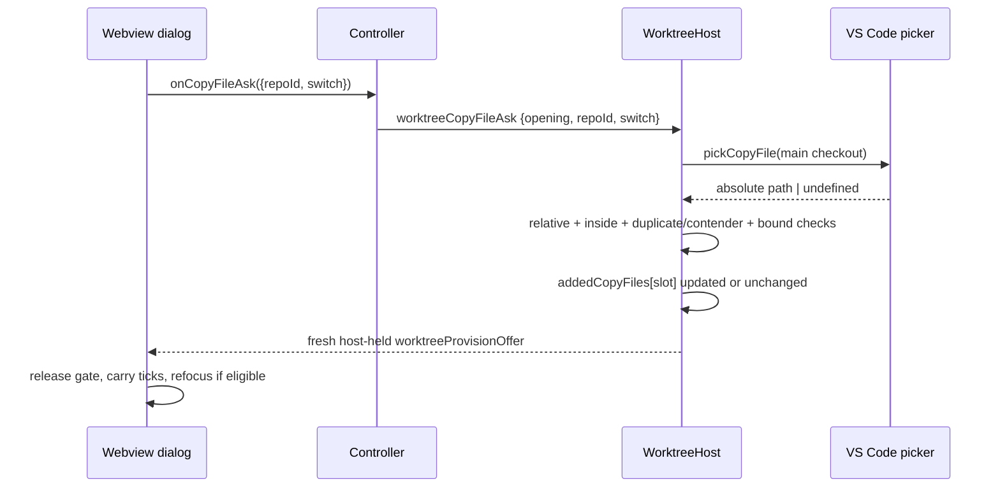

# Design: add a copy file for this create only

## Decisions

### D1: The host owns the picker and path

`WorktreeActions.pickCopyFile?(repoRoot: string): Promise<string | undefined>` opens
`vscode.window.showOpenDialog` with files-only, one selection, and `defaultUri` at the main checkout.
The webview never receives that absolute path. It posts only:

```ts
interface WorktreeCopyFileAskMessage {
  type: "worktreeCopyFileAsk";
  repoId: string;
  opening: number;
  switch: number;
}
```

`isKnownCopyFileAsk` applies `onlyKeys`. The host computes `path.relative(repo.mainPath, picked)`,
rejects empty/outside/absolute results, converts platform separators to repository POSIX spelling,
and does not read the file. Create's existing entry gate remains final authority over symlinks,
source identity, no-follow copying and destination containment.

### D2: One per-opening record, composed beside the setup record

The setup-specific source constant becomes `PROVISION_ADDED_SOURCE = "added for this create"` and
all current consumers move to it. Two records share the existing slot and lifecycle:

```ts
const addedCopyFiles = new Map<string, readonly string[]>(); // slot → repo-relative POSIX paths
const addedSteps = new Map<string, readonly string[]>();     // unchanged scripts
```

Both are capped at 32 and swept by `retireOpening`. `withAdded` strips marker entries, marker setup
rows and its tagged withholding problem before recomposing. It appends added copy entries first,
then added setup rows, because files materialize before setup runs. It uses the existing shared
`rowsOf ≤ MAX_MODEL_ROWS` bound and at most one generic withholding problem. A new add is admitted
only when both records plus the candidate fit the CURRENT source; a later denser source may show a
prefix, and switching back reveals the whole records again.

A candidate is rejected when its normalized identity already appears in base entries, base excluded
entries or `addedCopyFiles`, or when `contendersOf` says it could fold onto one of those names. A user
can tick an existing row instead; duplicating it would create two authorities for one destination.

### D3: The ask shares switch/save ordering and always answers

The copy ask takes the same `provisionSwitch` slot as setup asks, source switches and saves. The slot
is rechecked after the picker resolves and before the record changes. Cancel, picker rejection,
outside/empty/duplicate/contending path, record bound and model bound each reissue the current offer
unchanged; only a retired opening, outranked ask or gone surface stays silent.

### D4: The dialog has one form-wide async gate

`pendingCopy` mirrors the setup pending record with the old offer/model/selection and focus
eligibility. `anyAsking()` covers both maps, so either host-owned input holds Create, Save, source
switch, repository selector and both add controls. The answer carries selection by descriptor for
ordinary rows and by `addedCopyTicks[repoId]` for marker entries; this full-record ordinal vector
preserves an unticked hidden suffix across a denser source and back. A new file defaults selected.
Focus returns to `Add file to copy…` only when that button held focus at the press and the user did
not focus another dialog control while waiting.

The Save note becomes “Added files, setup steps and ports apply to this create only.”

### D5: Save cannot persist a picked file

`divergenceOf` ignores every entry whose `source === PROVISION_ADDED_SOURCE`, selected or not. Create
still receives selected entries from the host-held offer, so this affects only Save defaults. No
configuration shape changes.

## Architecture



## Interfaces

- `PROVISION_ADDED_SOURCE` replaces the setup-specific internal constant.
- `WorktreeCopyFileAskMessage`, added to `WorktreeInboundMessage` and `WORKTREE_MESSAGE_TYPES`.
- `WorktreeActions.pickCopyFile?(repoRoot: string): Promise<string | undefined>`.
- `WorktreeActionDeps.pickCopyFile(repoRoot: string): Promise<string | undefined>`.
- `WorktreeCreateDialogDeps.onCopyFileAsk?(request: { repoId: string; switch: number }): void`.

## Risk Map

| Component | Risk | Mitigation |
|---|---|---|
| wire | webview smuggles a path | message has no path field; `onlyKeys` and type-negative tests |
| picker result | outside/empty/platform path enters model | host-relative conversion and syntactic inside gate; apply-time authority unchanged |
| duplicate | two rows write one destination | exact identity plus possible-fold suppression (D2) |
| lifecycle | path leaks into another opening/repository | slot key shared with existing records; `retireOpening` sweep and sibling/reopen tests |
| ordering | slow picker publishes after source switch/save | shared `provisionSwitch` sequence, post-await recheck |
| model bound | copy record reopens the settled row-cap defect | composition only in `withAdded`, shared `rowsOf`, combined-record tests |
| save | picked path becomes standing consent | explicit marker skip in `divergenceOf` and assembly save witness |
| dialog | second picker opens or Create runs while first is open | one `anyAsking` gate over copy/setup pending maps |

## Obligation Ledger

| Claim | Semantics | Defeater | Witness/check | Disposition |
|---|---|---|---|---|
| No webview path becomes copy authority | inbound copy ask carries only repo/opening/switch; `ProvisionEntry.path` comes only from picker return held by host | a `path` key is accepted or a create message path is copied | type-negative + runtime `onlyKeys` tests; assembly test chooses path through fake picker then creates by item id | unresolved — until 1_1 / 4_1 land |
| Only an inside picked file enters the offer | nonempty relative result is neither absolute nor `..`; converted to POSIX; apply entry gate remains final | outside selection or empty repo-root selection appears, or an escaping symlink copies through | host outside/empty refusal tests; existing apply-entry symlink/containment suite | unresolved — until 2_1 lands |
| A duplicate/contender never enters | no normalized exact identity or possible-fold group with base/ excluded/record names | `.env` plus `.ENV`, or configured `.env` plus picked `.env`, produce two offered rows | host tests for configured, excluded, record duplicate and fold contender | unresolved — until 2_1 lands |
| Added files die with the opening and survive only its reissues | record keyed by slot, swept with opening; every issue path runs `withAdded` | sibling/reopen sees file, or switch/save loses it | host add → switch → save → close/reopen and sibling tests | unresolved — until 2_1 lands |
| Row bound remains global | combined copy+setup records plus base/problems stay `rowsOf ≤ MAX_MODEL_ROWS` at every issue | 32 copy + 32 setup rows pass cap or withholding problems stack | host combined-record dense-switch test and reissue idempotence | unresolved — until 2_1 lands |
| Checkbox state belongs to the record item | copy ticks are by full-record ordinal, written on toggle and applied on every answer | hidden unticked suffix returns selected after dense switch | dialog sparse → dense prefix → sparse test | unresolved — until 3_1 lands |
| Save never persists picked files | marker entries are omitted from divergence regardless of tick | native config gains copy/exclude/drop for picked path | pure divergence test and extension assembly save test | unresolved — until 2_1 / 4_1 land |
| Every admitted picker releases the form | every live highest ask posts one fresh offer, changed or unchanged | cancel/rejection/outside/duplicate posts nothing | host table tests; dialog cancellation answer releases all controls | unresolved — until 2_1 / 3_1 land |
