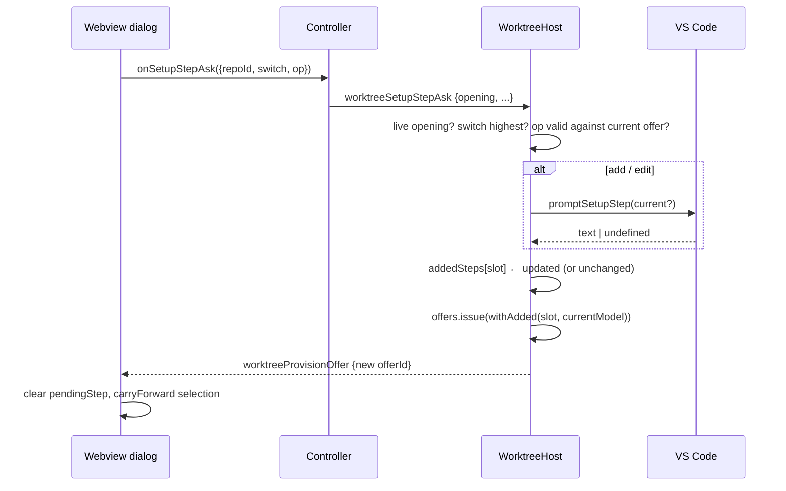

# Design: add-a-setup-step-for-this-create-only

## Decisions

### D1: The host owns the input, the way it owns the folder picker

The command is typed into `vscode.window.showInputBox`, opened by a new optional capability
`WorktreeActions.promptSetupStep?(current?: string): Promise<string | undefined>` beside `pickFolder`
(`WorktreeHost.ts:474`), wired in `createWorktreeActions` (`extension.ts:141`) through a new
`WorktreeActionDeps.promptSetupStep`. The text therefore exists first in the extension host and is
never in the webview as anything but display material.

Rejected: an `<input>` in the dialog posting its value. That is exactly the message § 4.0 forbids —
"a webview that could supply the command to run would be the authority on what runs" — and every
existing validator (`isKnownSwitch`, `isKnownSave`) is built on `onlyKeys` precisely so no field can
carry one.

### D2: One inbound message, three operations, no text field

```ts
export interface WorktreeSetupStepAskMessage {
  type: "worktreeSetupStepAsk";
  repoId: string;
  opening: number;          // the opening the form was composed in
  switch: number;           // the dialog's existing monotonic sequence, shared with switch/save
  op:
    | { kind: "add" }
    | { kind: "edit"; offerId: string; itemId: string }
    | { kind: "remove"; offerId: string; itemId: string };
}
```

`isKnownStepAsk` applies `onlyKeys` to the message AND to `op`, and requires `op.kind` to be one of
the three literals at runtime — the union is erased, and a `kind` the validator does not know is
refused, not routed (plan attack F5). `offerId` must be the offer the host currently holds for that
form, and `itemId` must name a `setup` row whose `source` is the added marker (D3). There is no outbound message of its own: every admitted ask is answered by re-issuing the
offer through the existing `worktreeProvisionOffer`, which is the reply the dialog already knows how
to apply.

Rides the `provisionSwitch` slot `${key} ${repoId} ${opening}` with latest-wins, exactly as switch
(`WorktreeHost.ts:3030-3100`) and save (D8 of the save change) do, so an ask, a switch and a save
order against each other and a stale one can never publish over a newer one.

### D3: Added steps are a per-opening record the host appends to every offer it issues

```ts
const SETUP_STEP_ADDED_SOURCE = "added for this create";   // src/types/messages.ts, shared
const addedSteps = new Map<string, string[]>();            // slot → scripts, in order
```

- Keyed by the same slot as `provisionBaseline` and swept by `retireOpening` (`WorktreeHost.ts:950`),
  so a close, a supersede or a detach drops them with everything else the form held.
- Every `offers.issue(offerKey, model)` for a form — initial read (`:3458`), switch (`:3090`), save
  (`:3164`) and the new handler — issues `withAdded(slot, model)`: the model's `setup` **with every
  marker row removed first**, followed by one `{ kind: "shell", script, source: SETUP_STEP_ADDED_SOURCE }`
  per recorded script. Stripping first is what makes it idempotent: the new handler builds from
  `offers.current`, which already carries the previous answer's marker rows, and appending onto that
  duplicated the record on every ask (plan attack F1). Ids are minted by the store like every other
  row, so the item id stays opaque and per-offer (§ 4.0).
- **A prompt's answer commits only if the ask is still highest.** The `provisionSwitch` slot is
  re-checked after `promptSetupStep` returns and before `addedSteps` is touched; an outranked ask
  mutates nothing and publishes nothing. So a switch taken while a prompt is open answers with the
  record as it was BEFORE that prompt — the step the user was typing is dropped with the ask that
  carried it, not resurrected into a source they moved on from.
- `edit`/`remove` locate the row by `itemId` in the CURRENT offer's `setup`, require the marker, and
  map to the record by ordinal among marker rows — the record needs no id of its own.
- Bounds: at most 32 recorded scripts per slot, and never past the model budget. **The bound is
  enforced inside `withAdded`, so every issue site obeys it** — initial read, switch, save reread
  and the ask handler alike; enforcing it at the add handler alone left a switch to a denser source
  free to reissue the whole record past the cap (review round 1 F003, round 2 F003). The rows a
  model holds are counted by one exported `providerKit` function, `rowsOf(model)` — entries,
  ports, setup, excluded and **problems**, every kind the read budget charges — so the host cannot
  keep a second formula that drifts from the reader's. `rowsOf` counts the FINAL model's rows,
  which is what the webview receives; it is at most the budget's spend, and less when the merge
  dropped a charged row (`readProvisioning.ts:270-278`, plan attack 7). **The issued bound is
  `rowsOf(offer.model) ≤ MAX_MODEL_ROWS`**: a capped read already emits `MAX_MODEL_ROWS - 1` rows
  plus its own cap problem, so `MAX_MODEL_ROWS` is what the reader can hand the host and exactly
  what `isKnownSave` admits back (plan attack 1). `withAdded` first strips the marker rows AND the
  host's own withholding problem (below), then appends the record's longest prefix that fits, with
  one slot held back for a problem row whenever any script does not fit: a `malformed` problem
  whose `file` is `SETUP_STEP_ADDED_SOURCE` — the same recognition rule as a marker row, so a
  reissue built from `offers.current` strips it rather than stacking it (plan attack 6) — stating
  how many added steps are not offered on this source. A base model that already holds
  `MAX_MODEL_ROWS` rows is a capped read carrying the reader's cap problem; every added step is
  withheld there and that problem is the statement, since no slot remains for another. The record
  itself is never truncated: a switch back to the sparser source offers every step again. Edit and
  remove address the record by ordinal among the marker rows shown, which is a prefix of it, so a
  withheld step cannot be edited or removed until it is shown again. An add is refused up front
  when the record holds 32 scripts, or when `rowsOf(base) + record.length + 1 > MAX_MODEL_ROWS`
  with `base` the current model stripped of markers and the withholding problem (plan attack 4);
  an accepted add fits the whole record, so it emits no withholding problem. The refusal answers
  with the offer unchanged. A script is refused when empty, whitespace-only, or longer than
  `MAX_SETUP_STEP_CHARS` (4096, exported once from `messages.ts` and read by both the host's refusal
  and the input's `validateInput` — round 1 F005). `showInputBox.validateInput` states the bound;
  the host enforces it regardless of what the input said.

`divergenceOf` (`writeNativeConfig.ts:125`) already leaves `setup` untouched, so a save cannot write
the step; that is witnessed rather than assumed (ledger).

### D4: Every admitted ask is answered; only a gone form is left silent

Same rule as the picker's D3. Cancel, a rejected `promptSetupStep`, empty, over-bound and a stale
`itemId` each re-issue the current model unchanged, so the form's gate is released by an offer id it
has not seen. The rejection arm is caught inside the handler, not left to `perform`'s logging wrapper
(`WorktreeHost.ts:2010-2013`), which posts nothing. Dropped
without answer only when the opening is not live, the `switch` is outranked, or the surface is gone —
the arms where nothing is waiting.

### D5: The dialog gates itself the way it gates a switch, and carries selection by ordinal

- A `pendingStep` record per repository, set when an ask is posted, cleared by the next new offer
  id for that repository. **The gate is form-wide**: while ANY ask is out the add/edit/remove
  controls, the save button, the switch rows and the repository selector are held, and Create is
  withheld with the same kind of reason the picker gives (`pickAsked`,
  `WorktreeCreateDialog.ts:2979`). Per-repository gating let a change of repository re-arm every
  control while the first repository's input was still open (review round 1 F002); holding the
  selector is what makes "the current repository" and "the repository that asked" the same thing.
  Without the Create hold the form could submit the previous offer in the window between the host
  confirming the text and the re-issued offer landing (plan attack F4).
- **Added rows carry their ticks by RECORD ordinal, in one per-repository vector.** Two added rows
  may carry the same script, so the script descriptor `carryForward` uses cannot tell them apart,
  and removing the first moved its tick onto the second (review round 1 F001). A snapshot of the
  SHOWN rows, taken at ask or switch time, was not enough either: a switch to a denser source shows
  a prefix of the record (D3), and a snapshot of that prefix forgot the ticks of every withheld
  step, which came back at its default on the switch back (plan attack 3). The dialog therefore
  keeps `addedTickRecord: Map<repoId, boolean[]>`, indexed by record ordinal, which is the shown
  marker's ordinal since the shown rows are a prefix: written on every toggle of an added row,
  extended with `true` when an add answers (a new step's default is **checked**, `bringRows`
  `:534`), spliced at the removed ordinal when a remove answers, and applied to the marker rows of
  EVERY answering offer — ask, switch and save alike — after `carryForward` or the defaults have
  filled the provider rows. The pending record carries only `removing`, so the splice lands once
  and on the right answer. A switch changes neither the record's count nor its order.
- The add control is the last child `bringBox` renders, after switch rows, and only while an offer is
  drawn. Edit and remove are icon buttons (`ICON_RENAME`, `ICON_CLOSE`) in the source cell of added
  rows only; provider rows keep the plain badge. **Their accessible name is bounded**: the action,
  the row's ordinal among added steps (1-based) and the script clipped to `STEP_NAME_CHARS` (48)
  with an ellipsis — a 4096-character command made a 4096-character name, twice per row (round 2
  F006). The full script stays in the row's code cell.
- **An answer restores focus.** The pending record remembers which action was pressed and on which
  ordinal; when the answering offer redraws the section, focus goes to the same ordinal's same
  action, to the successor ordinal's action after a remove (or the Add control when none remains),
  and to the Add control after an add. `replaceChildren` otherwise dropped the focused button and
  the trap left focus nowhere (round 2 F007). Eligibility is captured AT THE PRESS — the pressed
  control is `document.activeElement` — because `syncStepControls` disables it a moment later and
  a disabled control cannot hold focus (plan attack 5); a `focusin` on any other control of the
  dialog while the ask is out withdraws it, so a user who moved on is not pulled back.
- `WorktreeController` forwards the ask with the opening snapshotted at compose time, as it does for
  `onPickDestination` (`WorktreeController.ts:628`).

## Architecture



## Interfaces

- `WorktreeActions.promptSetupStep?(current?: string): Promise<string | undefined>`
- `WorktreeActionDeps.promptSetupStep(current?: string): Promise<string | undefined>`
- `WorktreeSetupStepAskMessage` (D2), added to `WorktreeInboundMessage`, `WORKTREE_MESSAGE_TYPES`,
  the host's route list (`WorktreeHost.ts:4478`) and `handleAction`.
- `WorktreeCreateDialogDeps.onSetupStepAsk?(request: { repoId: string; switch: number; op: WorktreeSetupStepAskMessage["op"] }): void`
- `SETUP_STEP_ADDED_SOURCE` exported from `src/types/messages.ts`.
- `rowsOf(model: ProvisionModel): number` exported from `src/worktree/provisioning/providerKit.ts` — the rows a model carries against `MAX_MODEL_ROWS`: entries, ports, setup, excluded and problems (D3).

## Risk Map

| Component | Risk | Mitigation |
|---|---|---|
| `isKnownStepAsk` | a smuggled field reaches the handler | `onlyKeys` on message and `op`; refusal test with an extra `script` key; `@ts-expect-error` case in `messages.contract.test.ts` |
| `addedSteps` | grows per ask, or outlives the form | bounded at 32 per slot; swept by `retireOpening`; sweep test |
| `withAdded` | duplicates marker rows when built from the current offer | strips marker rows before appending (D3); add → add → cancel test asserts two rows |
| Create gate | submits the pre-ask offer during the prompt | `pendingStep` withholds Create (D5); dialog test asserts Create disabled while an ask is out |
| offer re-issue on every answer | selection lost or moved on cancel, edit, remove or switch | added-row ticks snapshotted by ordinal on the pending record and applied per operation (D5); dialog tests for each answer kind, including two added rows with the SAME script, assert every tick stays on its row |
| `withAdded` past the budget | a 232-row offer whose full selection `isKnownSave` refuses, stalling a valid save; or a problem-bearing model admitting a step past the cap; or a reissue stacking the withholding problem | the bound lives in `withAdded` and counts rows through providerKit's `rowsOf`, problems included (D3); host tests: add at the bound refused and answered; 32 steps then a switch to a 199-row source → `rowsOf ≤ MAX_MODEL_ROWS`, full selection saved and answered, exactly one withholding problem after a further cancelled ask; a model of `MAX_MODEL_ROWS - 1` rows plus one problem refuses the add; a switch back shows all 32 |
| `showInputBox` that never settles | form gate held | same environmental unknown the picker accepted (its round-4 F007); no timeout added, same reasoning |
| save path | writes the step | `divergenceOf` ignores `setup`; host test asserts the written divergence carries none |

## Obligation Ledger

| Claim | Semantics | Defeater | Witness/check | Disposition |
|---|---|---|---|---|
| No text the webview sends is ever read as a command | No handler reads a string field of any inbound message into a `ProvisionSetupStep`; `worktreeSetupStepAsk` admits only `kind`, `offerId`, `itemId` and a known `kind` | A message with an extra `script` key is accepted and read; or an unknown `kind` is routed | `isKnownStepAsk` refusal tests: smuggled key at both levels, unknown `kind`; type-level `@ts-expect-error` on `{ op: { kind: "add", script } }`. The wider claim — no extra key ever crosses — is REFUTED by the plan attack: `worktreeCreate` is not `onlyKeys`-checked at the top level (`WorktreeHost.ts:2637-2661`), an extra key reaches the host and is ignored, and setup is redeemed from ids at `:2712-2736`. The narrowed claim is the one this change needs | unresolved — until 1_1 lands |
| Only a step this host's own input produced ever runs | Every `ProvisionSetupStep` the create receives is either from a provider read or from `addedSteps[slot]` written by `promptSetupStep`'s return | A create carrying an item id the current offer does not hold runs something | Existing "stale, unknown, or replaced offer runs nothing" tests; new host test: add via a fake `promptSetupStep`, create with its id, assert `runSetup` received that exact script and source marker | unresolved — until 2_1 lands |
| Added steps die with the opening | `addedSteps[slot]` is unreachable after `retireOpening(key)`; the next opening's first offer carries no marker row | A closed form's step appears in a reopened form, or in another repository's form on the same surface | Host tests: add → `worktreeCreateClosed` → reopen → offer has no marker row; two-repo test asserting B unaffected by A's add | unresolved — until 2_1 lands |
| Edit and remove reach only rows the host marked | `op.itemId` must resolve to a `setup` row of the CURRENT offer with `source === SETUP_STEP_ADDED_SOURCE`; provider rows are untouchable through this message | An `edit` naming a provider-declared step's id changes or removes it | Host test: edit naming the provider step's id → offer re-issued with the provider step byte-identical, `promptSetupStep` never called | unresolved — until 2_1 lands |
| An ask orders against switch and save | Same `provisionSwitch` slot; an ask whose `switch` is outranked after the prompt returns neither mutates `addedSteps` nor publishes | A slow ask answer lands after a later switch and shows the pre-switch source, or its text appears in the switched offer | Host test: add A → ask B (prompt held open) → switch → release prompt with "B" → exactly one offer published, it is the switched source, its marker rows are `[A]` only, `addedSteps` is `[A]` | unresolved — until 2_1 lands |
| A save never records the step | The divergence handed to `writeNativeConfig` carries no setup, marker or otherwise | The native file gains a `setup:` key | Host test asserting the divergence object has no setup; assembly test reading the written file after save | unresolved — until 2_1 / 3_1 land |
| The record is bounded | ≤ 32 scripts per slot, ≤ `MAX_SETUP_STEP_CHARS` each, and EVERY issued offer's `rowsOf` ≤ `MAX_MODEL_ROWS` whatever site issued it, all enforced host-side; the offer carries one marker row per record entry that fits and at most one withholding problem when any does not | An input answering a 1 MiB string is offered; or repeated asks grow the offer by duplicated marker rows (F1) | Host unit test on the 33rd add and on a 4097-char answer: offer unchanged; and add → add → cancel → offer has exactly two marker rows | unresolved — until 2_1 lands |
| Every admitted ask releases the form | For every ask the host admits (live opening, highest switch, live surface) exactly one `worktreeProvisionOffer` is posted | Cancel, a rejected prompt, or a stale `itemId` posts nothing and Create stays withheld | Host tests over cancel, a `promptSetupStep` that rejects, empty answer, over-bound answer, stale `itemId`, unknown `kind` on a live form, each asserting one offer; dialog test cancel → controls and Create re-enabled | unresolved — until 2_1 / 2_2 land |
| A prompt that never settles | `showInputBox` that neither resolves nor rejects holds the form's gate | Stuck form | n/a — the identical environmental unknown the picker change recorded as its residual (its design D3 / round-4 F007); no new mechanism here, and a timeout would introduce the late-answer race that residual explains | n/a — inherited residual, stated |
