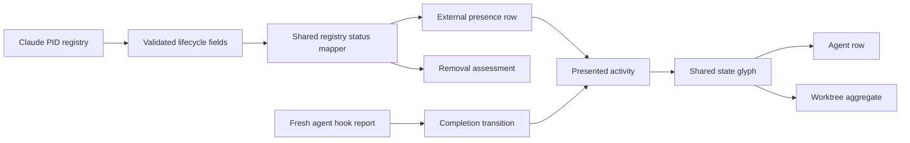

# Design: richer-agent-status

## Architecture

## Decisions

### D1: One exact registry status mapping serves every consumer

The registry reader accepts only `busy`, `waiting`, and `idle`; a shared pure mapper returns `running`, `waiting`, `idle`, or no activity respectively. External presence and removal assessment both consume that mapper.

`statusUpdatedAt` is a state-transition timestamp. The effective row time is `max(statusUpdatedAt, launch-or-first-seen)`: an impossible pre-launch transition is clamped to the session floor, an absent timestamp falls back to that floor, and scans never advance it. An absent or unknown status yields unknown presentation and an unproven removal state rather than an active or idle guess.

Shipped baseline at `0de80546`: the reader discards lifecycle fields and external presence hardcodes every live PID as running. The current working tree contains a partial busy/idle patch; the build must add waiting, remove false completion, and centralize the mapping rather than preserve that intermediate shape.

### D2: Done is presentation derived from an authoritative completion fact

The wire activity union remains `running | waiting | idle | exited`. `done` joins only `PresentedActivity`, derived when a row is idle and carries a completion time.

A completion time is written only from a fresh non-boundary hook report whose state is `done`, using that report's `stateStartedAt`. Reprojecting the same report therefore cannot move the age. A new running/waiting turn, a new session identity, or any session boundary clears it. Registry idle, output silence, and shell-title fallback never create it.

This also handles a done report arriving after inference already made the pane idle: the explicit completion fact is recorded even when the wire activity does not change.

### D3: Attention outranks execution, evidence gaps outrank history

The presented precedence is:

`waiting > running > running-unconfirmed > unknown > done > idle > exited`

The exact presented vocabulary feeds agent glyphs, worktree aggregation, collapsed summaries, labels, and accessibility text. `done` is retained while the row exists and no later turn supersedes it; this change adds no dismissal or historical-row retention mechanism.

### D4: Borrow Orca's semantics, retain Anywhere's shape discipline

| State | Shape | Theme treatment | Motion |
|---|---|---|---|
| running | open arc | warm activity/yellow token | continuous rotation |
| waiting | message-question outline | attention/orange token | optional non-rotating pulse |
| done | circle-check | success/green token | static |
| idle | small filled dot | muted foreground | static |
| running-unconfirmed | existing double ring | blue token | static |
| unknown | existing dashed ring | muted foreground | static |
| exited | existing horizontal dash | disabled foreground | static |

Waiting and done use trusted inline SVG constants rendered through the existing `stateShape` primitive. CSS owns animation; no interval, recurring timer, or per-row JavaScript phase loop is added. Reduced-motion disables rotation and pulse while every state remains distinct by outline.

### D5: Every agent shares the renderer, not the same evidence

The glyph vocabulary is agent-neutral, but each row may present only states its current evidence can prove:

| Agent | Local evidence in this change | External evidence | Eligible presentation |
|---|---|---|---|
| Claude | structured working / waiting / done hooks plus pane fallback | machine-wide busy / waiting / idle registry | full planned vocabulary, including done |
| Cursor | hook working / idle plus pane fallback | none | running or idle from its hook; fallback waiting/unconfirmed/unknown/exited where pane evidence supplies them; no done |
| OpenCode | session identity plus pane fallback | none | fallback running/waiting/idle/unconfirmed/unknown/exited; no done |
| Codex | pane/process/title fallback | none | fallback running/waiting/idle/unconfirmed/unknown/exited; no done |

`monitoring`, `blocked`, `interrupted`, manual workflow statuses, and new non-Claude transports remain out of scope. Orca can render them because it owns additional status and retention contracts; copying only their glyphs would invent states Anywhere cannot currently prove.

## Obligation Ledger

| Claim | Semantics | Defeater | Witness/check | Disposition |
|---|---|---|---|---|
| Registry status is never guessed | Exact allow-list; absent/unknown maps to no activity | A future status silently becomes running or idle | Reader + shared-mapper tests for valid, absent, and invalid values | supported |
| Registry timestamps do not manufacture freshness | Effective time is the transition timestamp clamped to launch/first-seen; scans add no freshness and no TTL | Repeated scans move age/rank, or a pre-launch timestamp survives below the session floor | Projection tests for repeated scans, missing timestamps, and pre-launch ordering | supported |
| Completion means an ordinary reported turn ended | Only non-boundary hook `done` writes completion time | Registry idle, quiet output, shell reclaim, or SessionStart draws a check | Projector tests for each transition plus presented-state tests | supported |
| Removal and display read the same lifecycle state | One mapper feeds both consumers | UI says idle while removal treats the same record as running/unknown | Mapper consumption tests in presence and session views | supported |
| Quiet lists stop moving | Continuous rotation exists only on confirmed running | Done, idle, unknown, exited, or unconfirmed CSS still animates | Shipped-DOM/CSS tests with reduced motion and animation inspection | supported |

## Risk Map

| Component | Risk | Mitigation |
|---|---|---|
| Claude registry parser | External format adds or corrupts states | Exact allow-list; invalid values remain absent; finite non-negative timestamp guard and projection floor |
| Shared status mapping | Presence and removal drift | One pure mapper imported by both paths, with table-driven tests |
| Completion clock | Duplicate projections refresh a finished row | Use hook `stateStartedAt`, not projection time |
| Session boundaries | Resume/clear inherits a green check | Clear completion independently of whether wire activity changed |
| Presented vocabulary | New `done` rows disappear from summaries or cannot win aggregation | Exhaustive vocabulary membership and precedence tests |
| Glyph rendering | Colour or motion becomes the only distinction | Shape-first SVG/CSS tests, monochrome and reduced-motion assertions |
| Agent-specific evidence | A shared glyph invents done/waiting for an agent that never reported it | Cross-agent tests prove presentation follows row evidence, not agent identity |
| Render cost | Richer icons add per-frame DOM work | Trusted static SVG; compositor CSS only; no new clocks or row reconciliation |
