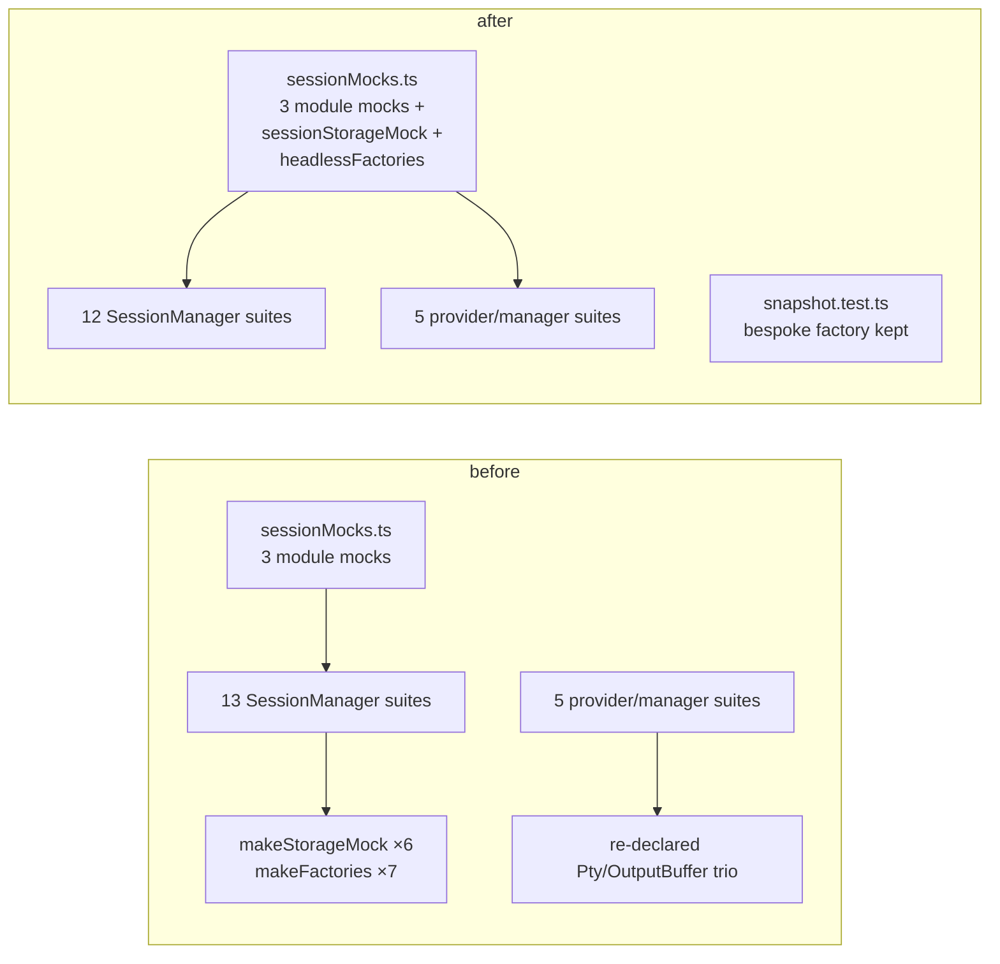

# Design: share-session-manager-test-fixtures (refactor: `src/test/sessionMocks.ts`)

## Diagnosis

| | |
|---|---|
| Target | `src/test/sessionMocks.ts` |
| Lines at start | 101 |
| Shape | `unremarkable` (from `asm refactor shape`) |
| Because | "101 lines is under the 200-line floor for shape analysis" — the defect is **not** in the target |
| Direct tests | NONE. The net is the 18 consumer suites plus a new `src/test/sessionMocks.test.ts` pinning the factory contract (task `1_2`) |
| Why now | Slop audit U-18 and I-06, deferred at audit time pending this fixture design; caller asked to finish the audit's deferred items |

The target is a shared module that is too *small*: it stops at the three module mocks and
leaves the SessionStorage double and the headless/serialize factory pair to 13 local copies,
while 5 further suites bypass it entirely. This is a duplication defect measured across
consumers, not a shape defect in the file.



## Decisions

### D1: Target structure

Everything lands in the existing owner `src/test/sessionMocks.ts`, whose header already
states the rule this change extends: *"Each factory is the superset of what the per-file
copies had drifted into, so a caller that does not use a member simply ignores it."* No new
file, no new directory — a second module would split one concept across two homes.

Option shape follows the established repo precedent `src/test/providerTestUtils.ts`
`mockExtensionContext(options)`: a single options object, explicit per-suite overrides, and a
doc comment naming why each variant exists.

```
src/test/
  sessionMocks.ts       # SessionManager/Pty module mocks + the storage and factory doubles
  sessionMocks.test.ts  # pins each factory's default and each override (new, task 1_2)
```

Left in the consumer suites on purpose: every value a suite asserts on. The factories own the
*structure* of the double (member set, generation bookkeeping, callback wiring); each suite
keeps ownership of its own *values* by passing a closure. This is what makes the migration
behavior-preserving without an interchangeability claim the variants do not support.

Clusters ordered by coupling ascending.

| # | Cluster | Consumers | Deps | Technique | Task |
|---|---|---|---|---|---|
| 1 | `sessionStorageMock` + `headlessFactories` + widened module mocks | — | 0 | extract superset with options | `1_1` |
| 2 | Contract test for the new factories | 1 | 1 | additive test | `1_2` |
| 3 | Storage/factory suites on the plain `/tmp/` prefix | 3 files | 1 | call-site swap | `2_1` |
| 4 | Storage/factory suites on the `/tmp/snap/` prefix | 2 files | 1 | call-site swap | `2_2` |
| 5 | Backing-store and sink variants | 3 files | 1 | call-site swap with overrides | `2_3` |
| 6 | I-06 suites needing no extra control | 2 files | 1 | module-mock swap | `3_1` |
| 7 | I-06 suites carrying extra controls | 3 files | 1 | module-mock swap + local override | `3_2` |

**Deliberately not cut:** `SessionManager.snapshot.test.ts`'s `makeFactories`. Its addon
double records `id`, `calls`, `output`, `disposed` and `lastOptions`, exposes `addonCtorCount`,
pushes into a per-headless `addons` array, and its `write` deliberately does **not** invoke the
callback the other six do. That instrumentation is the subject under test (SerializeAddon
caching), so a generic helper would hide the thing the suite exists to observe. 6 of 7
`makeFactories` copies migrate; this one stays.

### D2: Preservation proof

| | |
|---|---|
| Suite command | `pnpm run test:unit` |
| Baseline | **7845** tests across **304** files green at `34a7680d`, type-check clean |

Rules every task obeys:

- Baseline suite green after every task. The count is a tripwire — a drop, or a test-file edit
  not predeclared in D3/D4 or the task's Plan, stops the task: revert, never adjust a test to
  fit. The unexpected edit is a design change — reopen approval.
- Growth is additive only. The one added test file is named in `1_2`'s Plan.
- Re-run `asm refactor shape` on `src/test/sessionMocks.ts` after task `1_1` — a superset that
  grows the module past the 200-line floor into a new shape has moved the defect, not removed it.
- The same step failing twice means the seam is wrong, not the edit — stop and re-plan.

### D3: Expected test moves

Mechanical only: deleting a local `makeStorageMock`/`makeFactories`/`vi.mock` block and
importing the shared factory in its place, plus the `mockPtySessions.length = 0` reset that
adopting `ptySessionMock()` requires (OBL-7). **No assertion changes anywhere.**

- `src/session/SessionManager.settingToggle.test.ts`, `.editorPanels.test.ts`, `.deactivate.test.ts`: local doubles deleted, shared factories imported; no assertion changes.
- `src/session/SessionManager.persist.test.ts`, `.shutdownLifecycle.test.ts`: same, with `bufferFilePath` and serialize closures passed as options; no assertion changes.
- `src/session/SessionManager.hydrate.test.ts`, `.agentHooks.test.ts`, `.exit.test.ts`: same, with the backing-buffer option and the write sink passed as options; no assertion changes.
- `src/providers/TerminalEditorProvider.onReady.test.ts`, `src/providers/TerminalViewProvider.restore.test.ts`: re-declared trio replaced by the shared module mocks, `mockPtySessions` reset added; no assertion changes.
- `src/providers/TerminalEditorProvider.test.ts`, `src/providers/TerminalViewProvider.test.ts`, `src/session/SessionManager.test.ts`: same, each keeping its extra control as a local override in the `vi.mock` factory; no assertion changes.

### D4: Allowed non-pure transformations

- `1_1`: the six `makeStorageMock` copies differ in unused parameter lists
  (`commitBufferSync(id)` vs `(id, _data)`, `commitIndexSync()` vs `(_idx)`). The shared double
  declares the widest signature. Behavior-preserving: the extra parameters are unread in every
  copy, and `vi.fn` records the arguments the production call actually passes either way.
- `1_1`: `scheduleLivePanelsWrite` is present in only 2 of the 6 storage copies. The shared
  double always provides it, per the module's stated superset rule. Behavior-preserving: a
  suite that never calls it cannot observe it.
- `3_1`/`3_2`: adopting `ptySessionMock()` gives these suites the `onData`/`onExit`
  getter-setter pair that mirrors into `mockPtySessions`, replacing plain fields. The observable
  read-back through the property is identical; the mirroring is additive.
- `2_1`/`2_2`/`2_3`: the six copies' three different `bufferFilePath` prefixes collapse to one
  fixed stub. Behavior-preserving because the injected double's `bufferFilePath` is never called
  — `SessionStorage` calls only its own (D6).
- `3_1`/`3_2`: each adopting suite gains `mockPtySessions.length = 0` in its `beforeEach`. This
  is the hygiene the 13 suites already using the shared mock all perform; it is predeclared here
  because it is an edit the migration adds rather than moves.

### D5: Obligation ledger

Two hard requirements constrain the same state: every factory must be a **superset** of the
copies it replaces, and it must **not change what any migrated suite observes**. A superset
that answers where a stub used to refuse satisfies the first and breaks the second. Each row
below is a place those two pull apart.

Dispositions below are the oracle's, written back after its falsification pass. Four claims
the first draft carried were removed rather than re-witnessed: the oracle showed they are not
load-bearing, because nothing production reads can observe them. They are recorded as inert
differences in D4 instead, and two of them shrink the change — see D6.

| id | claim | semantics | defeater | witness / check | disposition |
|---|---|---|---|---|---|
| OBL-4 | Serialize output identity is per-suite | the option closure decides the value; per-addon capture (`persist`) and per-call increment (`shutdownLifecycle`) both remain expressible | Baking one counter into the shared factory; `persist`'s two reads of one addon start differing, `shutdownLifecycle`'s `setNextSerialize` has nowhere to live | X: `src/session/SessionManager.shutdownLifecycle.test.ts:239-248` observes the one-shot override; `src/session/SessionManager.snapshot.test.ts:137-150` independently catches production addon reconstruction | supported |
| OBL-5 | Disposal tracking survives where a suite asserts it | with `track`, `builtHeadless`/`builtAddons` expose `disposed`, flipped by `dispose()` | Dropping the tracking arrays because only one suite reads them; `settingToggle`'s disposal assertions lose their subject | X: `src/session/SessionManager.settingToggle.test.ts:111-130` — catches deleting the mirror/addon disposal in `SnapshotPersistence.setRestoreEnabled` (`SnapshotPersistence.ts:165-179`) | supported |
| OBL-6 | `exit`'s write sink still records every write | `onWrite` receives each `write(data)` in order, and the write callback still fires | Adding the sink but dropping the `cb?.()` call, or vice versa; `exit`'s tail assertions see the wrong payload or the flush barrier never lifts | X: `src/session/SessionManager.exit.test.ts:67-85` — catches removing the post-exit guard (`SnapshotPersistence.ts:479-486`); `src/session/SessionManager.settingToggle.test.ts:160-162` — catches dropping the callback passed at `SnapshotPersistence.ts:501-514` | supported |
| OBL-10 | `SessionManager.test.ts` keeps its own pty-handle instrumentation | its tracked handle exposes `spawn`, `write`, `resize`, `kill`, `setShellIntegrationSink` and a captured `shellIntegrationSink`, none of which the shared 3-field handle has | Replacing it with `ptySessionMock()`'s `{ id, onData, onExit }` handle because the trio "looks duplicated" | X: `src/session/SessionManager.test.ts:462-470` — catches a shared handle that cannot capture the shell-integration sink | supported |
| OBL-11 | No production file is added or edited | no path outside `src/test/**` and `*.test.ts` appears in the working tree as modified **or untracked** | A "small fix" to production code to make a suite fit the shared double; `git diff --name-only` alone would not see a newly added untracked file | X: `git status --porcelain -- src \| grep -v -E '(^.. src/test/\|\.test\.ts$)'` returns empty — catches an untracked production file, which the first draft's `git diff --name-only` missed | supported |

### D6: Claims removed after the oracle pass

Each was a `supported` row in the first draft. The oracle refuted or left unresolved the
witness, and verification confirmed the underlying difference is unobservable. Two of them
remove work from the change.

| removed | why it is not load-bearing | effect on the plan |
|---|---|---|
| default storage double refuses to read back buffers | Production reads buffers only through hydrate (`SnapshotPersistence.ts:850-875`), and the one migrated hydrate consumer opts into `buffers`. No default-helper consumer reaches the refusing reader through production. | none — the default still refuses, for fidelity to the six copies |
| each suite keeps its own `bufferFilePath` string | `bufferFilePath` is called only by `SessionStorage` on itself (`SessionStorage.ts:245,312,336,379`). The only member the SUT calls on the *injected* double is `bufferFileRelativePath` (`SnapshotPersistence.ts:901`). The three prefixes are inert in all six copies. | **the `bufferFilePath` option is dropped**; the double carries one fixed stub |
| generation bookkeeping is identical to every copy | Two reasons, the second load-bearing. (a) The two suites that assert concurrency replace the decision outright with `commitBufferAsync.mockImplementation` (`persist.test.ts:175-188`, `shutdownLifecycle.test.ts:215-229`), so the shared implementation is not what those tests exercise. (b) For the four suites that do **not** override — the case (a) does not cover — no suite asserts on `currentBufferGen`/`currentSidecarGen` at all; production reads them only to capture `capturedGen`. Round-1 review raised (a) as under-argued and supplied (b); the bookkeeping was kept verbatim regardless. | none — the bookkeeping stays, for fidelity to the six copies |
| the widened `ptyManagerMock` spawns a usable pty | All five I-06 suites mock `PtySession`, so `SessionManager` calls that mocked instance's `spawn` (`SessionManager.ts:464-490`) and never dereferences `loadNodePty().spawn`. The rich inline fake in `onReady.test.ts:8-23` is already dead in its own suite. | **the `ptyManagerMock` widening is dropped from task 1_1** |
| adopting `ptySessionMock()` needs a per-suite `mockPtySessions` reset | The shared lookup misroutes only on a duplicate id (`sessionMocks.ts:54-67`); the adopting provider cases use random UUIDs or a single fixed `S1` and never inspect the handle. A missing reset would leave the suite green. | the reset is still added, as predeclared hygiene in D4 — not as a ledger claim |

## Risk Map

| Risk | Mitigation |
|---|---|
| A superset answers where a stub refused, flipping a branch silently | Defaults stay refusing; every widening is opt-in by option and pinned by `sessionMocks.test.ts`. The oracle pass found no consumer that observes the difference (D6), so this risk is smaller than the first draft assumed |
| The audit's "byte-identical, replace outright" for `onReady`/`restore` is stale — verified false on `34a7680d` (their `PtySession` uses plain fields, their `OutputBuffer` omits `isOutputPaused`) | `3_1` treats them as widening tasks, not swaps |
| A "duplicated-looking" trio is replaced where the suite actually depends on richer instrumentation (OBL-10) | `3_2` keeps `SessionManager.test.ts`'s tracked-handle type and its `setShellIntegrationSink` capture as a local override; only the members it does not drive come from the shared double |
| A migrated suite passes for the wrong reason — the shared double never being reached | Assertion changes are forbidden (D3); the baseline count is a tripwire; `1_2` tests the factory directly rather than through a consumer |
| The change grows `sessionMocks.ts` past the shape floor and recreates a structural defect | D2 re-runs `asm refactor shape` on the target after `1_1` |
| Suite-order flakiness masks a leaked pty handle | OBL-7's witness runs both directories together, the order in which the leak would show |
