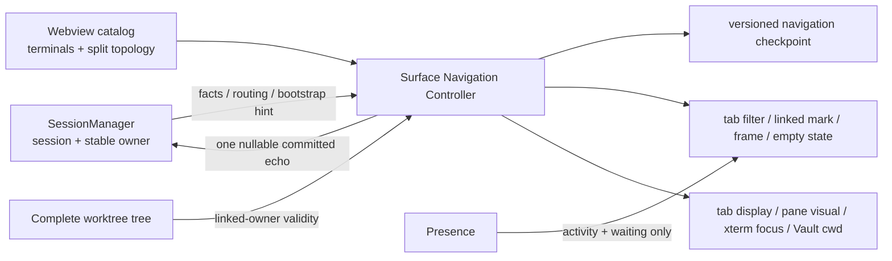

# Design: unify-terminal-navigation-state

## Architecture



## Decisions

### D1: Authority follows the state boundary

`SessionManager` is canonical for session existence, PTY lifecycle, surface membership, stable `worktreeId`, snapshot facts, and cross-surface routing. Each webview owns one navigation controller because it alone holds split topology and DOM focus.

The host keeps a nullable echo of the surface's last committed active tab and pane for host commands and in-memory re-resolve. That echo stores a result; it never initiates navigation and snapshot replay order never makes it remembered user selection.

### D2: Owner and checkpoint are total and versioned

```ts
type TerminalOwner = { kind: "main" } | { kind: "linked"; id: string };

interface TerminalNavigationCheckpointV1 {
  version: 1;
  activeOwner: TerminalOwner;
  activeTabId: string | null;
  activePaneByTab: Record<string, string>;
}
```

Main is one global terminal bucket across all workspace repositories. It maps to no repository-specific active row. Optional `worktreeId` remains only at the session message boundary, where absence decodes to `{ kind: "main" }`.

A linked owner with `activeTabId: null` is a valid owner-empty state. Missing tree information does not invalidate it; only a complete current tree that excludes the linked id does.

### D3: Navigation commits against one catalog snapshot

The controller receives a read-only catalog snapshot containing terminal owner facts, tab layouts, and live leaves. Each intent computes a complete next state, checks the two predicates below with independent predicates, commits once, and only then runs effects.

- `activeTabId === null` or the tab contains a live pane owned by `activeOwner`.
- Every `activePaneByTab[tab]` names a live leaf of that tab.

Catalog/topology mutation and its navigation intent run in one controller transaction: no rendering, persistence, focus, Vault synchronization, or host message may occur between them. Intents raised by an effect are queued until the current effect batch finishes. A generation token cancels delayed fit/focus effects after a newer transition.

Effect order is: render projections → display tab/pane → update split visual → focus xterm → synchronize Vault → persist checkpoint → emit one host echo. A no-op intent performs zero effects.

### D4: Every navigation ingress has one transition

| Intent | State result |
|---|---|
| `selectOwner(owner)` | Keep a valid tab/pane of that owner; otherwise choose a deterministic owner tab/pane or its empty state. |
| `selectTab(tabId)` | Derive owner from a live display pane, retain a valid pane in that tab, and commit owner + tab + pane together. |
| `focusSession(paneId)` | Find the containing tab, derive stable owner from the pane, and commit owner + tab + pane together. |
| `terminalCreated(tabId, owner)` | Register terminal and leaf first, then commit owner + tab + pane together. Vault Resume and Continue use this intent. |
| `paneFocused(tabId, paneId)` | Commit the exact DOM-focused live leaf without a second direct store write. |
| `paneClosed(tabId, paneId)` | Remove topology, clamp to a live sibling, or choose another tab of the same owner. |
| `tabClosed(tabId)` | Remove the tab and select another tab of the same owner; if none exists, retain the owner-empty state. |
| `replaceLastTab()` | Request one terminal in the retained active owner; its `terminalCreated` response performs activation. |
| `splitCompleted(requestId, paneFact)` | Attach to the captured source tab; activate only if that tab is still active. |
| `restore(catalog, checkpoint, bootstrap)` | Validate after catalog construction, apply one checkpoint or fallback, then render once. |
| `ownersReconciled(liveLinkedIds)` | Reassign affected local facts to main, then normalize owner + tab + pane once. |

### D5: One host echo updates both routing consumers

The webview sends one internal message after a committed transition:

```ts
{
  type: "terminalNavigationCommitted";
  activeTabId: string | null;
  activePaneId: string | null;
}
```

The provider validates that `activePaneId` is a session in its view and that its `rootTabId` equals `activeTabId`; a retained split leaf may therefore remain active after the original root session exits. A null pair clears both `SessionManager` root-tab activity and the provider's last-active-pane cache. A valid pair updates them together. Existing tab-switch and focus messages stop writing those stores independently.

### D6: Restore has explicit warm cold and legacy precedence

Restore first registers all terminal facts and reconstructs split topology without navigation effects. It then applies this precedence:

1. A valid `TerminalNavigationCheckpointV1`. If its active tab survives, that tab's terminal fact determines owner; a conflicting saved owner is ignored. If its tab is null, its explicit owner-empty state is retained.
2. On an in-memory re-resolve only, a validated nullable host echo when no checkpoint exists.
3. A legacy `worktreeScope` on an in-memory re-resolve only, when neither checkpoint nor host echo exists.
4. Main with a deterministic displayable main tab/pane, or main's empty state.

A stale pane is clamped within its surviving tab. A stale tab is replaced within the checkpoint owner. A linked owner is retained until a complete tree proves it absent. Exited panes remain displayable facts and may satisfy restore even though they have no running PTY.

`resetWorktreeScope` is replaced by an explicit `navigationBootstrap: "live" | "cold"` init field. Cold bootstrap discards legacy scope but never deletes the new checkpoint. Any consumed legacy scope is removed and immediately rewritten as V1. This supersedes `docs/DESIGN.md` D50.

### D7: Split completion is correlated and cannot orphan a session

A split request captures `{ requestId, sourceTabId, sourcePaneId, direction }` before IPC. The host validates the source session and creates the child with the source's current stable owner and `rootTabId: sourceTabId`. The response carries the same request and session identities but no independent webview owner choice.

On receipt, the controller finds the captured source leaf in `sourceTabId`, derives the child's local owner from the current source fact, and attaches there regardless of the currently active tab. If owner reconciliation already reached the surface, both panes therefore use main; if it has not, the next reconciliation moves both together. The new pane becomes active only when its source tab remains active.

The webview acknowledges attached or rejected. The host retains the new child as pending until acknowledgment; failed delivery, rejection, timeout, or source-session disappearance destroys only that never-attached child. An attached terminal is never rolled back by this protocol. Pending requests are bounded and cleared on surface disposal.

### D8: UI state is projection, not another navigation store

Tab membership is exact stable-owner equality. A linked active owner marks its matching worktree row and renders the linked frame and compact indicator. Main marks no worktree row and renders no linked frame or indicator. Roving keyboard focus, expansion, search, menus, and disclosure remain independent UI state.

`selectedWorktreeId`, scope resolution, and persisted mutable scope are removed as navigation writers. During migration, `tabBarScope` may remain only as a stateless projection adapter.

Presence contributes waiting/activity decoration and hidden-waiting counts, never membership or owner transitions.

## Obligation Ledger

| ID | Claim | Semantics | Defeater | Witness/check | Disposition |
|---|---|---|---|---|---|
| OBL-1 | Owner is total and stable | Every live/displayable pane resolves to main or one linked id; CWD/presence never mutates it | A producer emits an ownerless third state or presence moves membership | X: `src/session/TerminalOwnership.integration.test.ts` and `src/webview/navigation/TerminalOwnerProjection.test.ts` — catch creation, split, snapshot, reconciliation, CWD, and presence mutations | supported |
| OBL-2 | Active navigation is coherent | After every commit, active tab belongs to active owner and each active pane is a live leaf | A catalog sequence leaves another-owner tab or stale pane active | X: `src/webview/navigation/TerminalNavigationState.property.test.ts` — independent predicates over generated catalogs catch reducer validation or clamping mutations | supported |
| OBL-3 | One intent produces one non-reentrant commit | Accepted intent has one effect batch; no-op has none; delayed effects cannot outlive a newer generation | Owner projection recursively activates another pane or stale focus runs later | X: `src/webview/navigation/TerminalNavigationComposition.test.ts` — real adapters catch old owner-before-pane, tab-created, focusin, and delayed-focus writers | supported |
| OBL-4 | Restore cannot revive contradictory navigation | V1 checkpoint and explicit precedence apply after full catalog construction | Snapshot replay order or legacy scope overrides saved active tab/empty owner | X: `src/webview/navigation/TerminalNavigationRestore.integration.test.ts` — catches warm/cold, exited, stale-root, legacy, and synthetic host-activity mutations | supported |
| OBL-5 | Surfaces navigate independently | State/checkpoint are per surface; host routes only to pane-holding surface | Focus or revival of one surface changes another | X: `src/extension.worktreeAssembly.test.ts` — catches target routing, shared state, and editor/sidebar revival mutations | supported |
| OBL-6 | Split tabs have one owner | Child derives source owner and reconciliation moves every pane in the tab together | Delayed response introduces a different owner | X: `src/providers/TerminalViewProvider.test.ts` and `src/webview/split/SplitTreeRenderer.test.ts` — catch stale payload owner and active-tab-based attachment mutations | supported |
| OBL-7 | Every created split child reaches a terminal state | Child is attached and acknowledged, or its pending creation is rolled back within the timeout | Delivery/rejection leaves a host session unreachable from every tab | X: `src/providers/TerminalViewProvider.test.ts` — catches missing ack timeout, source disappearance, and failed-delivery cleanup mutations | supported |

## Risk Map

| Component | Risk | Mitigation |
|---|---|---|
| Reducer adoption | A missed direct writer recreates divergence | Inventory and remove writes from `main.ts`, `SplitTreeRenderer`, `TerminalFactory`, scope wiring, focusin, and WorktreeView; OBL-3 runs through their real adapters. |
| Navigation checkpoint | Stale ids or exited roots can select nothing | D6 validates displayable leaves independently from PTY liveness and preserves explicit owner-empty state. |
| Host echo | Root tab id and active pane id can diverge | One nullable message validates view membership and `rootTabId`, then updates both routing caches together. |
| Cross-surface focus | Target view may reload or lack a worktree tree | Host routes pane identity only; target derives owner from terminal facts and checkpoint without requiring labels. |
| Split completion | Async response can target the wrong tab or outlive source/surface | Correlated source-tab request plus attachment acknowledgment and bounded rollback of never-attached child. |
| Owner disappearance | Reconciliation can interleave with split/restore | Local child inherits current source fact; one owner reconciliation moves the complete tab and normalizes navigation. |
| Legacy migration | Old reset flag can erase new state | Explicit live/cold bootstrap, checkpoint-first precedence, one-shot legacy consumption, then field removal. |
| Documentation | Applied inspector and `All` contracts contradict shipped UI | Spec delta removes stale cluster; dedicated docs test reads every changed navigation document. |
| Navigation maps | Maps grow with tabs and panes in one surface | Entries are created/deleted with live topology and bounded by existing live/restored session caps. |
